# Build log: Pico Chess Card

After my tic-tac-toe business card, I decided to build a more advanced version you can play chess on.

**Goals**

- Pass-and-play mode (one device, two people taking turns)
- Online 1v1 over nRF24L01
- NFC tap to open a website or enter pairing mode (saved for later)

**Components**

- RP2040, crystal and flash
- USB-C
- Waveshare 2.7-inch e-paper display

I posted these as devlogs on [Hack Club Flavortown](https://flavortown.hackclub.com/projects/11454) while building the project: 18 entries and 31 h 18 min of logged work, 13 Feb 2026 to 26 Apr 2026. The text is lightly edited for spelling and clarity; dates are UTC.

| # | Date | Logged | Entry |
|---|---|---|---|
| 1 | 13 Feb 2026 | 1 h 23 min | [Starting with the screen](#1--starting-with-the-screen) |
| 2 | 15 Feb 2026 | 1 h 0 min | [Footprints, and a mystery connection](#2--footprints-and-a-mystery-connection) |
| 3 | 15 Feb 2026 | 1 h 29 min | [Screen module routed](#3--screen-module-routed) |
| 4 | 16 Feb 2026 | 57 min | [A schematic mistake, rerouted](#4--a-schematic-mistake-rerouted) |
| 5 | 16 Feb 2026 | 53 min | [Main schematic, roughly done](#5--main-schematic-roughly-done) |
| 6 | 16 Feb 2026 | 21 min | [NFC added](#6--nfc-added) |
| 7 | 15 Mar 2026 | 2 h 12 min | [Schematic locked; card size and placement](#7--schematic-locked-card-size-and-placement) |
| 8 | 16 Mar 2026 | 1 h 24 min | [Routing the RP2040 cluster](#8--routing-the-rp2040-cluster) |
| 9 | 16 Mar 2026 | 1 h 41 min | [Most of the routing, and a button swap](#9--most-of-the-routing-and-a-button-swap) |
| 10 | 16 Mar 2026 | 2 h 22 min | [Routing and DRC done](#10--routing-and-drc-done) |
| 11 | 17 Mar 2026 | 36 min | [Last fixes, and the order](#11--last-fixes-and-the-order) |
| 12 | 23 Mar 2026 | 1 h 0 min | [A peeled pad](#12--a-peeled-pad) |
| 13 | 25 Mar 2026 | 1 h 57 min | [The second screen module works](#13--the-second-screen-module-works) |
| 14 | 27 Mar 2026 | 6 h 5 min | [Six hours and a burnt regulator](#14--six-hours-and-a-burnt-regulator) |
| 15 | 27 Mar 2026 | 0 min | [Four attempts, and the real mistake](#15--four-attempts-and-the-real-mistake) |
| 16 | 27 Mar 2026 | 1 h 8 min | [Power section redesigned around the RT6150B](#16--power-section-redesigned-around-the-rt6150b) |
| 17 | 26 Apr 2026 | 3 h 48 min | [Reflow attempt 2](#17--reflow-attempt-2) |
| 18 | 26 Apr 2026 | 3 h 4 min | [Reflow attempt 3: it works](#18--reflow-attempt-3-it-works) |

---

## 1 · Starting with the screen
13 Feb 2026 · 1 h 23 min logged

Let's begin the journey towards the chess card. The most important part is the screen:

- Drew the schematic for the screen module.
- Imported symbols from EasyEDA.
- Picked the FPC-05FB-24PH20 connector.

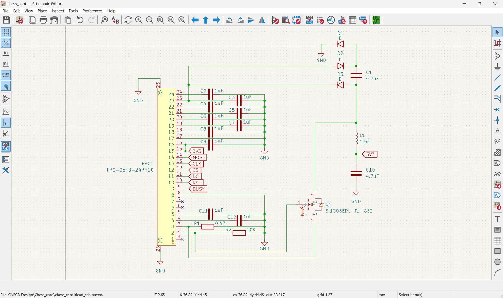

---

## 2 · Footprints, and a mystery connection
15 Feb 2026 · 1 h 0 min logged

For the past hour I was assigning footprints to every part, which took a while because each one also
had to be found on LCSC. I kept changing the inductor size, going from 0402 to 0603 to 0805 (which I
believe is enough). I also hit some capacitor issues: somehow I had connected pin 1 to pin 3, and I
have no idea how. Now, on to routing the first screen module.

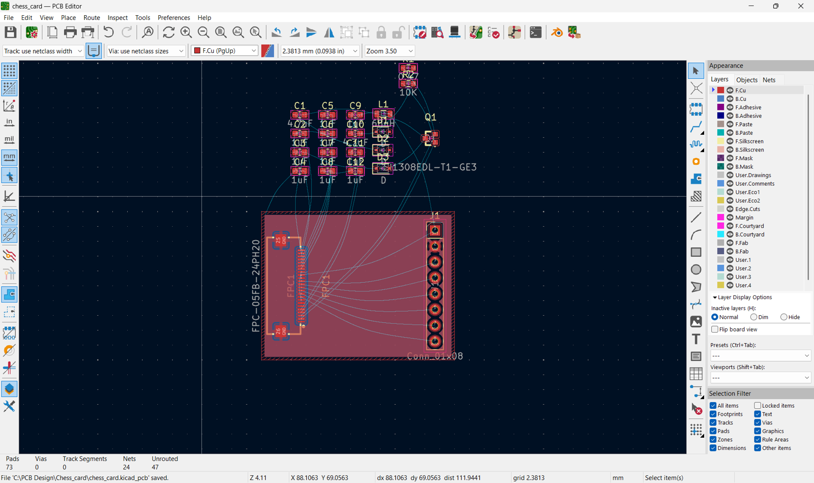

---

## 3 · Screen module routed
15 Feb 2026 · 1 h 29 min logged

Finally completed the routing for the whole screen module. Getting all the display traces to line up
without messing up the rest of the board was honestly annoying, but it's done. I also rendered it in
KiCad so you can see what the final board should look like. So hyped for this to be real.

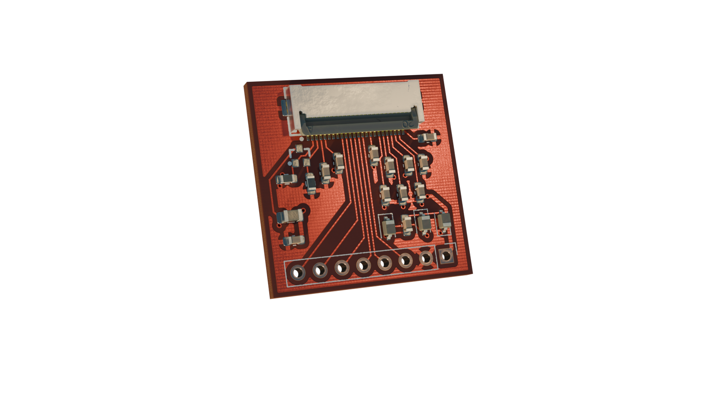
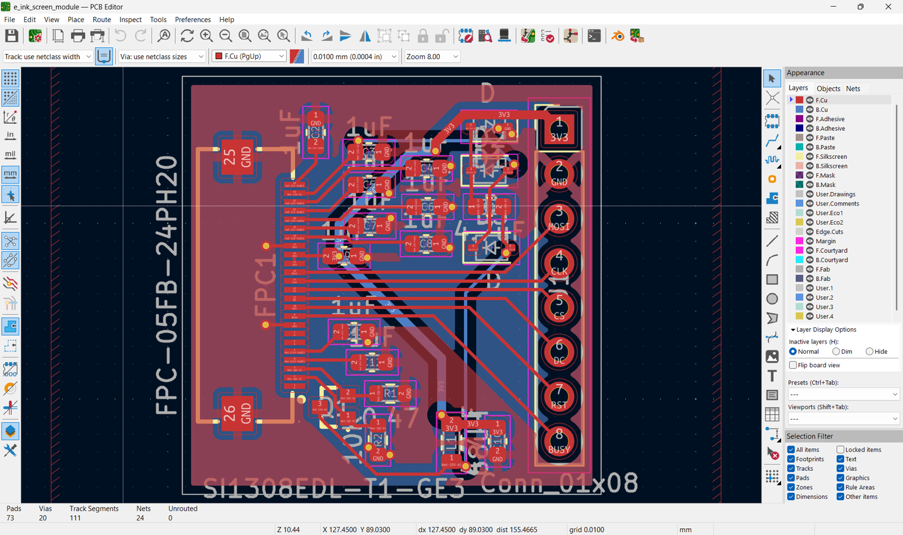

---

## 4 · A schematic mistake, rerouted
16 Feb 2026 · 57 min logged

I messed up the schematic, so I spent the past hour rerouting everything, especially since my
schematic and PCB layout had somehow fallen out of sync. Here's the final result.

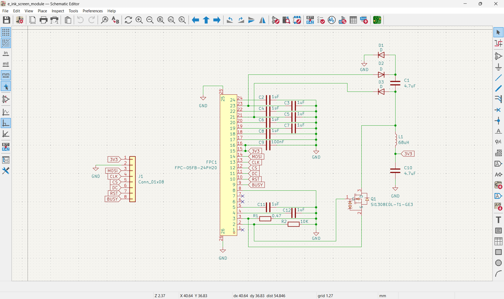
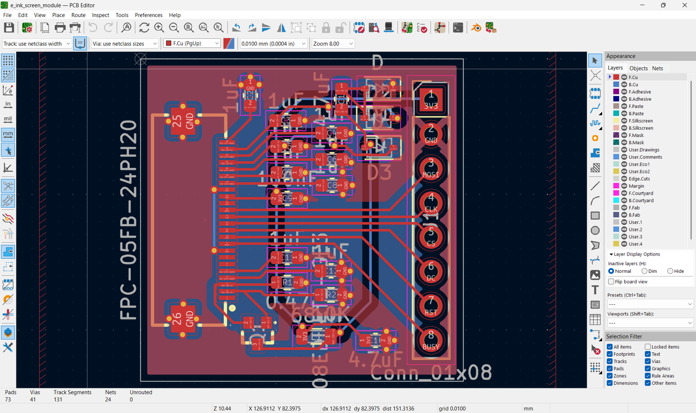

---

## 5 · Main schematic, roughly done
16 Feb 2026 · 53 min logged

Roughly finished the schematic:

- RP2040 cluster
- NFC
- E-paper screen
- nRF24L01 (not added yet)

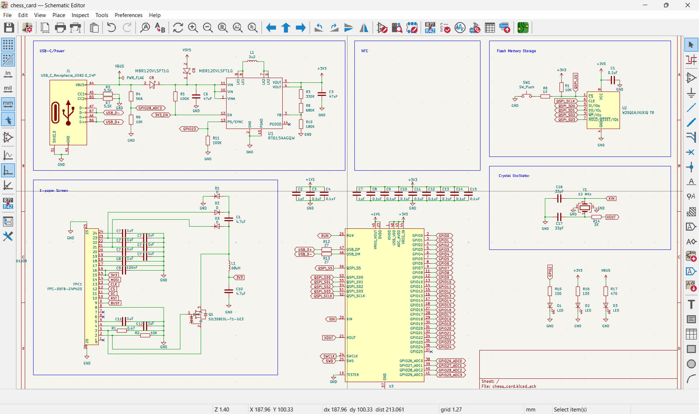

---

## 6 · NFC added
16 Feb 2026 · 21 min logged

Added the NFC feature and imported the footprints.

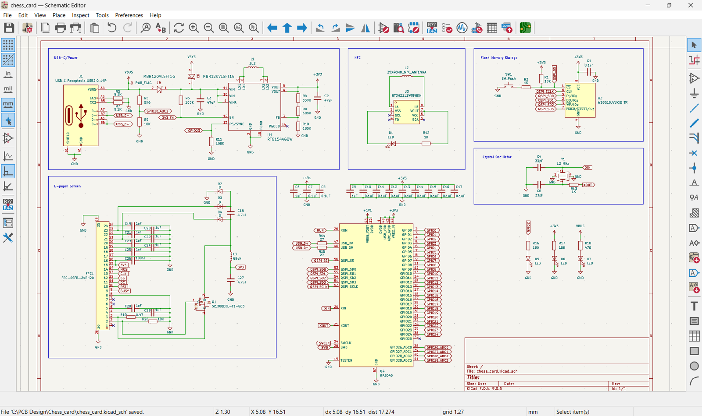

---

## 7 · Schematic locked; card size and placement
15 Mar 2026 · 2 h 12 min logged

A few things today.

**Finalised the schematic.** I double- and triple-checked every pin, the SPI lines and the power
delivery, so hopefully I don't short out another regulator or blow up my USB port again.

**Set the card size.** I locked in the board's physical dimensions, going with a sleek card size so
it feels like a legit, highly portable device rather than a big clunky dev board. It's going to look
so clean.

**Placed the components.** I started dragging the footprints onto the board. Squeezing the RP2040,
the flash, the screen connector and all those tiny capacitors into a card-sized area is a giant
puzzle, but the main clusters are now placed.

I'm feeling good about the layout. Routing all these traces next will probably be a nightmare in
KiCad, but we're getting there.

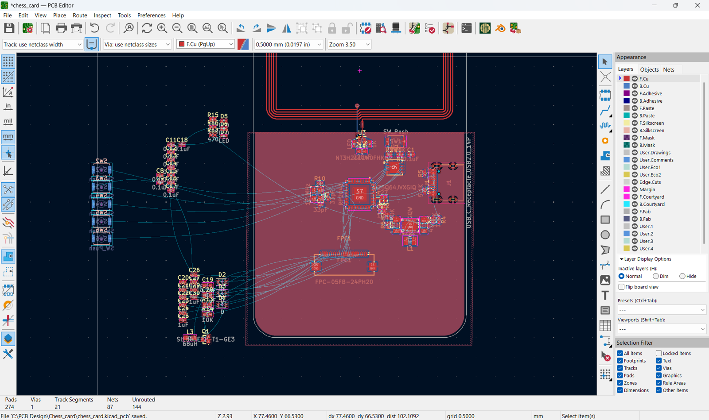

---

## 8 · Routing the RP2040 cluster
16 Mar 2026 · 1 h 24 min logged

Spent almost an hour and a half routing the RP2040 cluster today. This session was fairly easy,
because there are hardly any complex peripherals on this part of the board: far less of a headache
than ripping up power islands and shorting regulators, as I usually seem to do. The main focus was
wiring up the screen connector, making sure every display line is routed cleanly so it actually
talks to the MCU instead of showing a blank white screen when I plug it in.

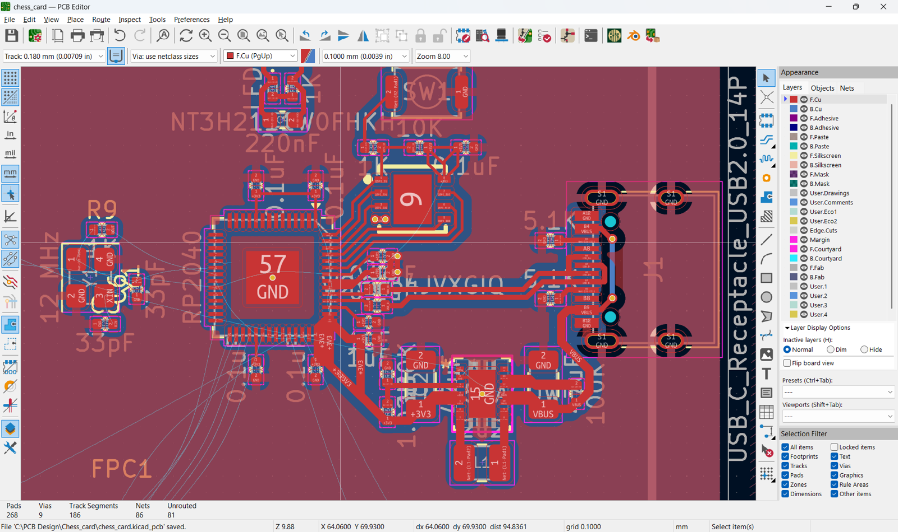

---

## 9 · Most of the routing, and a button swap
16 Mar 2026 · 1 h 41 min logged

Quick progress today: I sat down for two hours and knocked out almost all the routing.

**Routing.** Much easier than I expected, probably because there are hardly any complex peripherals
on this board apart from the SPI lines. Far less of a headache than the shorted power islands last
time.

**Button swap.** I ripped out the old buttons and replaced them with the same ones I used on my
tic-tac-toe business card. Those had a solid tactile feel, so I'm hoping they work better for a
handheld game layout.

We're getting very close to finishing this board.

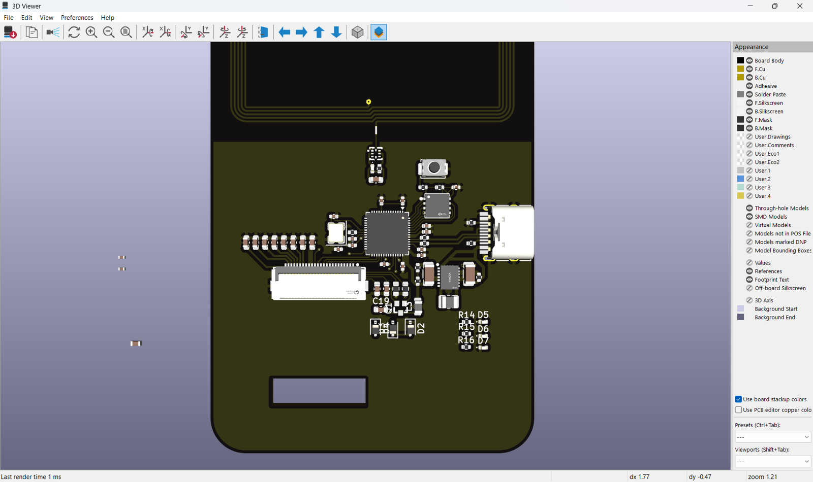

---

## 10 · Routing and DRC done
16 Mar 2026 · 2 h 22 min logged

Finally finished the routing and the DRC check, and rendered the board to show it off. Routing was
fairly easy this time, and I love how straightforward the hardware is; I think the real challenge
will be the software.

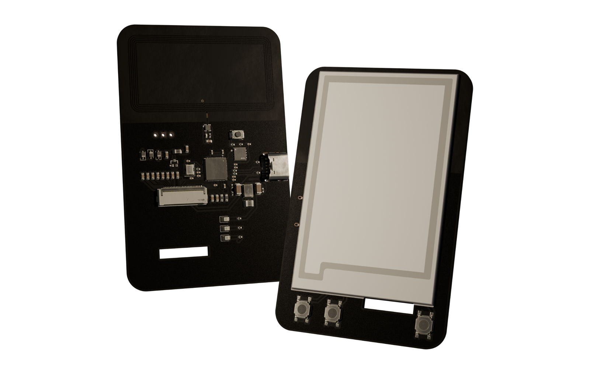

---

## 11 · Last fixes, and the order
17 Mar 2026 · 36 min logged

- Added a pull-up resistor on PSYNC.
- Added a test pad for PGOOD.
- Ran DRC and fixed the pin-header connector.
- Ordered the board.

(I did this work the day before but was too busy to post a devlog.)

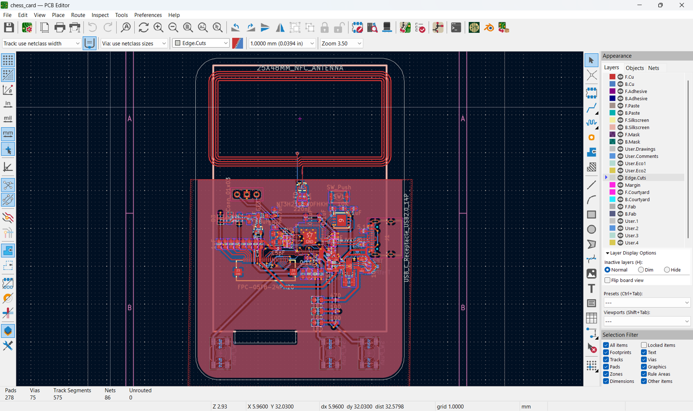

---

## 12 · A peeled pad
23 Mar 2026 · 1 h 0 min logged

I accidentally peeled off a solder pad when I had almost finished soldering everything. All that
time for nothing. Never mind; I'll solder another one tomorrow (look at the little diode flying
around).

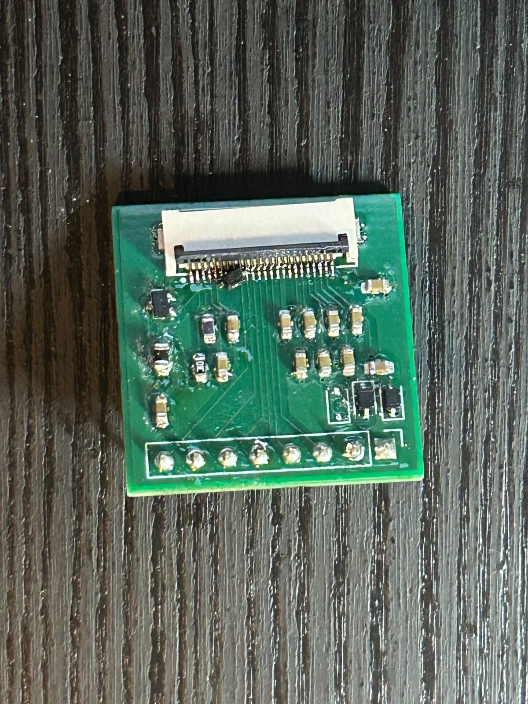

---

## 13 · The second screen module works
25 Mar 2026 · 1 h 57 min logged

More big progress: I reflowed another screen module, and it just worked. I also quickly prototyped
the chessboard; here's how it looks. I really thought my breakout module wouldn't work, since it was
my first time making one; maybe I just got lucky.

▶ [Video (2.3 MB)](media/34480-1.mp4)

---

## 14 · Six hours and a burnt regulator
27 Mar 2026 · 6 h 5 min logged

Six hours, and my eyes ached from staring into the microscope.

I reflowed my first board today, and thought everything had gone well until I plugged in the USB-C
and saw actual magic smoke. The RT6154A burnt: it puffed smoke, got extremely hot and died in front
of me. I was scared I had somehow sent 5 V straight into the RP2040 and fried the whole MCU cluster.

For about two hours I stared at the schematic in KiCad looking for a fatal design flaw. I started
overthinking the power circuit, worrying that I'd missed an external trace between the regulator's
VINA and VIN pins. I was about to rip up the whole layout when I remembered that they're already
connected internally on the 6154, so that wasn't the cause.

So I grabbed my multimeter and checked resistances everywhere. The burnt regulator was, unsurprisingly,
shorted between VOUT and GND, but after taking it off I also found some sketchy solder balls hiding
under the tiny decoupling capacitors next to it.

It took another two hours to desolder the dead RT6154A with the hot-air gun and clean the pads with
solder wick. My hands were shaking so badly from stress that I nearly ripped a pad off (the board
looks very messy now).

My best guess is a big short under the IC from my uneven solder-paste application: I probably put
far too much paste on the centre ground pad, and it squeezed out and bridged everything. I'm hoping
it's just a reflow error and nothing more fundamental; if it's a routing issue I'll be devastated.

It's very late and my brain is fried, so I'm scrapping this board, resting, and reflowing another
tomorrow with brand-new parts. Praying it doesn't end in fire this time.

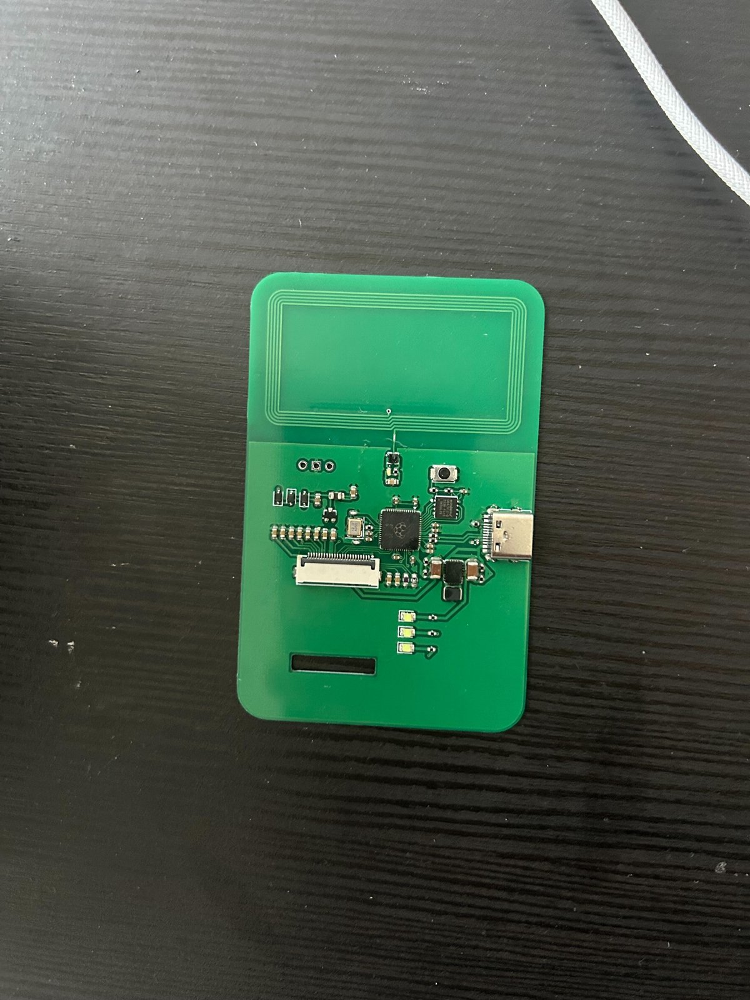

---

## 15 · Four attempts, and the real mistake
27 Mar 2026 · 0 min logged

I tried four times and burnt all my RT6154As and 47 µF capacitors. The results of each attempt:

1. The regulator smoked, but then the 3.3 V LED blinked, and I thought it had started working, until
   my computer couldn't access any files.
2. I moved most of the parts from the first board to this one, and somehow 5 V wasn't even
   responding.
3. This time I built only the power block, and it correctly produced 3.3 V, which made me think the
   power block wasn't the issue.
4. I reflowed the whole thing again, and 3.3 V was shorted to GND until I removed the RP2040.

Then I realised my mistake: the Raspberry Pi Pico uses the RT6150, not the overkill RT6154. I'll
redesign the power section around the RT6150B for this board, though I still plan to use the RT6154
on my dev board.

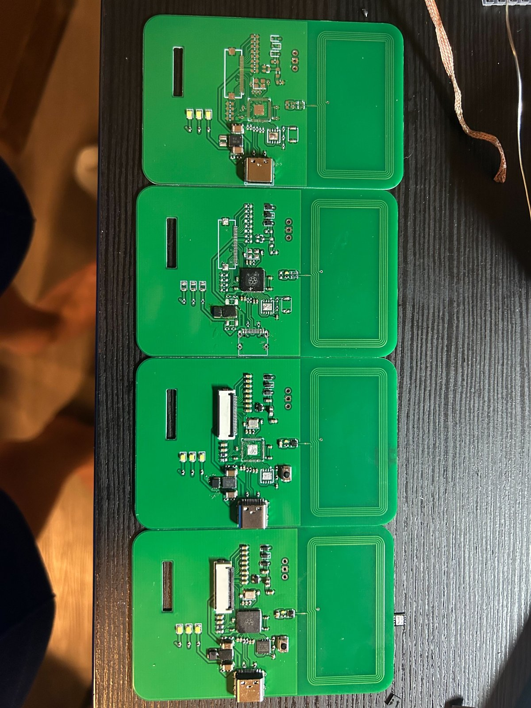

---

## 16 · Power section redesigned around the RT6150B
27 Mar 2026 · 1 h 8 min logged

Fixed the schematic and footprint; this time I'm actually using the RT6150B.

- Imported the symbol and footprint.
- Rerouted the power-supply chain (easier than I expected).
- Ran DRC.

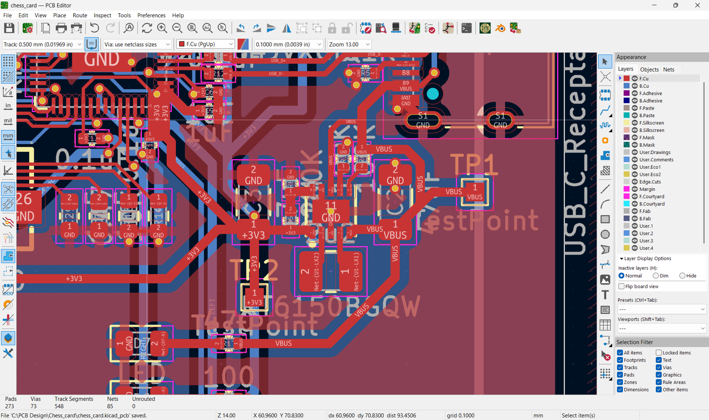

---

## 17 · Reflow attempt 2
26 Apr 2026 · 3 h 48 min logged

This one nearly broke me: almost four hours of reflowing and debugging.

- I reflowed the whole chess card, and neither the 5 V nor the 3V3 indicator lit up.
- At first I blamed the USB-C port, since I had kept going over it with my 300 °C soldering iron to
  fix bridges. I swapped the port, but that didn't fix it.
- I then measured the resistance between 5 V and GND and found it suspiciously low, nearly 0 Ω:
  clearly a short.
- I suspected the RT6150, the only IC besides the USB-C that sits between 5 V and GND. I reflowed
  it, and the 5 V indicator came on.
- But 3V3 still wasn't lighting up, even after another reflow of the buck regulator. This took over
  an hour: the resistance between 3V3 and GND was normal (very high), so I began to suspect I had
  burnt the RT6150 when 5 V was shorted.
- I replaced the RT6150 with a new one (only four left in stock), and it started to sort of work:
  the 3V3 light came on. But BOOTSEL was dead; the board wouldn't talk to the flash.
- If 3V3 hadn't come on at all, the short probably never got past the regulator, so the flash
  shouldn't be the problem. I turned to the RP2040 instead and reflowed it, but the same thing
  happened.
- I then swapped in a new RP2040 (I still have quite a few), and the board went completely dead:
  the 3V3 indicator no longer came on.

It's 2 a.m. and I'm devastated. Time to rest before trying again.

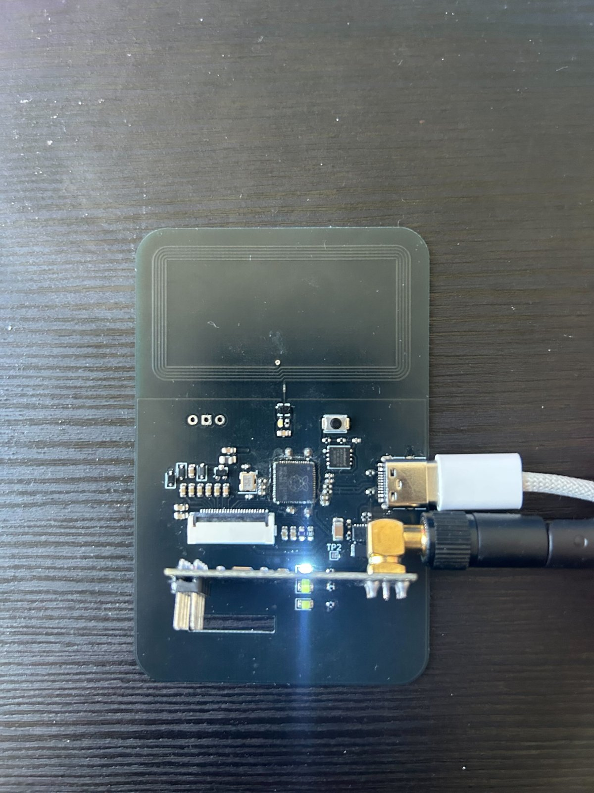

---

## 18 · Reflow attempt 3: it works
26 Apr 2026 · 3 h 4 min logged

It finally works. I could actually cry.

- After going to bed at 2 a.m. feeling defeated, I woke up and stared at the dead board for about
  20 minutes. I realised that when I swapped the RP2040 the night before, sleep-deprived and
  rushing, I had probably ruined the QFN ground pad under the chip, which is why the board died and
  took 3V3 with it.
- I got out the flux and the hot-air gun and gave the MCU one last reflow. I was extremely careful
  and didn't touch the soldering iron at all, having learned my lesson from frying the USB-C port.
- I plugged it in, and both the 5 V and 3V3 indicators lit up immediately. Seeing the 3V3 light come
  back was a huge relief, but I was still holding my breath over yesterday's flash problem. I held
  BOOTSEL, plugged the USB into my laptop, and hoped.
- It showed up on my computer. BOOTSEL works and the flash communicates perfectly now. I dragged in
  the MicroPython UF2 and it loaded without any disconnects. Best of all, I finally got to test the
  e-ink screen: I hooked it up, wrote a quick MicroPython test script, and watching the display
  refresh and show my output was incredibly satisfying. The chess card is finally alive.

Moral of the story: never solder tiny chips at 2 a.m. with a fried brain. I'm so happy right now.

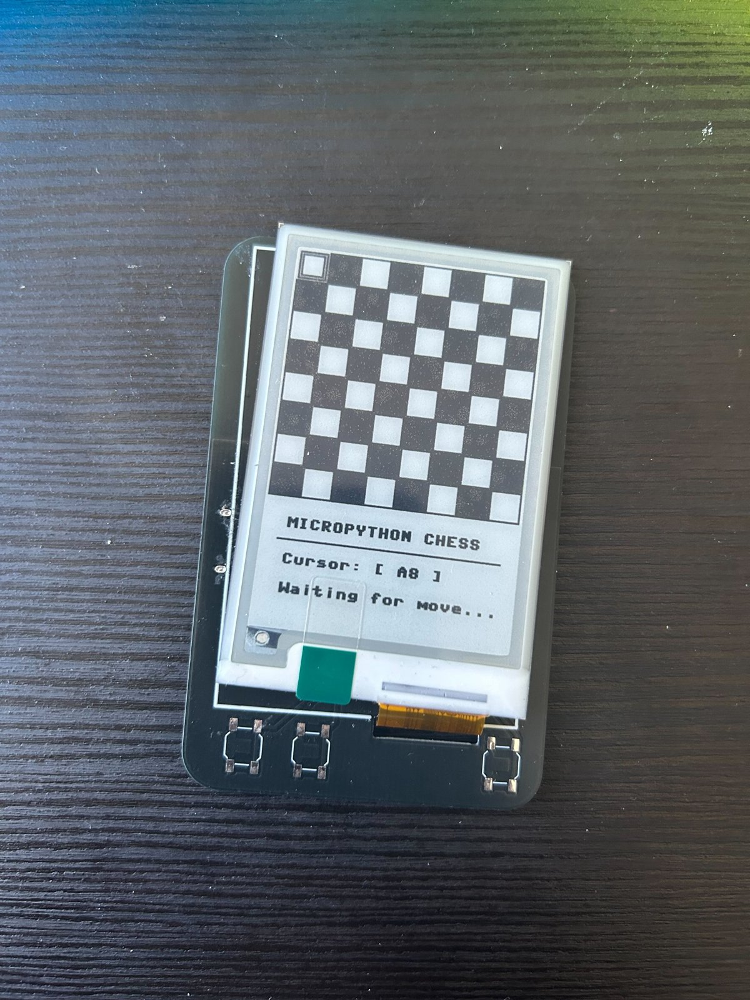

